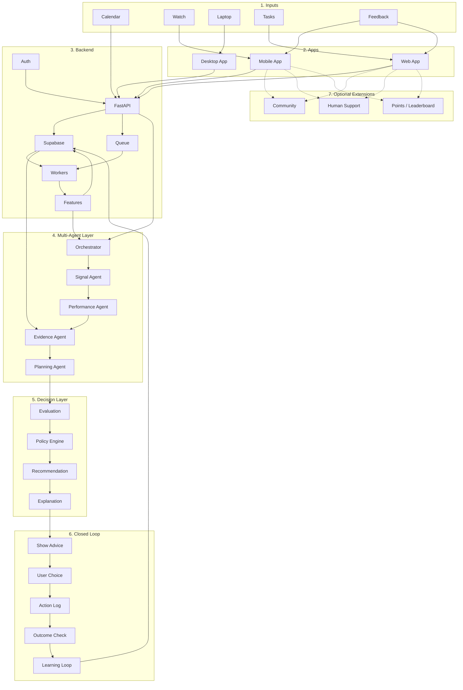

# Cognitive-Performance-Agent

This project is mainly for Students and Athletes, answering questions like "Should I keep going or take a break?” OR “When am I most ready to perform at my best?"

## System Design

