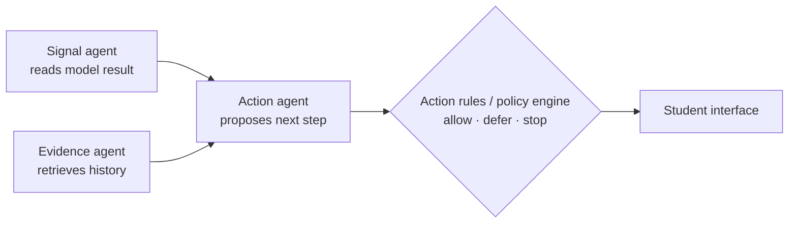

# Multi-Agent Decision

Stage 4 of the [[07-backend/system-architecture|system architecture]], and the only place the multi-agent model is used. It combines the current estimate from the [[04-agent-engine/performance-model|performance model]] with personal history, and explains the suggestion with cited records.

## The roles

| Role | Does | Must not |
|---|---|---|
| **Signal agent** | Reads the numeric estimate, recent features and missing-data notes. Can call the scoring tool and spot gaps, trends and uncertainty. | Invent missing measurements, override quality gates, or make a medical diagnosis |
| **Evidence agent** | Retrieves context for the LLM (RAG). Must cite provenance. | Treat retrieved text as instructions. It's untrusted input. |
| **Action agent** | Proposes a typed action (**continue, short walk, quiet break/rest**) from an allowlist, with a short rationale linked to evidence/features | Pick anything outside the allowlist |
| **Policy engine / action rules** | Ordinary code that authorizes, modifies, delays or rejects the proposal: consent, freshness, confidence, quiet hours, snooze, rate limits, recent prompts, user preferences | — (it's deterministic; **the LLM cannot override it**) |
| **Orchestrator** | Runs the stages, applies timeouts, records versions, handles failure, retries, idempotency and a non-LLM fallback | — |

[[22-entities/langgraph|LangGraph]] coordinates the roles and tool calls. One LLM can serve all roles, so no separate agent servers are needed.

### What the Evidence agent retrieves differs between designs ^[ambiguous]

The Evidence agent is the project's [[21-concepts/retrieval-augmented-generation|retrieval-augmented generation (RAG)]] step.

- **Raghavan:** the user's own past sessions, preferences and outcomes from PostgreSQL. Start with plain SQL retrieval; semantic vector search can wait.
- **Alexa:** *approved research/evidence snippets* with source metadata, filtered by topic, population, recency and provenance, stored as `evidence_sources` / `evidence_chunks` with pgvector embeddings.
- These could be combined: personal history from SQL plus a curated research corpus. ^[inferred]

## Recommendation flow (Alexa, 8 steps)

1. Trigger on a user request, task-session event or consented scheduled evaluation.
2. Check consent, source freshness, coverage and user-level rate limits.
3. Compute the feature window and get a versioned model prediction.
4. Retrieve relevant approved evidence.
5. Ask the LLM adapter for a **structured** candidate action and rationale, if the workflow needs one.
6. Validate the schema and semantic constraints, then run the deterministic policy engine.
7. Persist the candidate, policy decision, versions and rationale **before** presenting it.
8. Collect the user response and completion, and link later task outcomes to the session.

## Failure behaviour

- **LLM timeout or outage:** use a deterministic template or give no personalized recommendation.
- **Evidence retrieval down:** use a clearly labelled pre-approved generic message, or abstain. Never fabricate citations.
- **Stale or low-coverage data:** say the system lacks enough recent information.
- **Policy rejection:** record a reason code and don't show the rejected candidate.
- **Retries:** bounded exponential backoff, idempotency keys, dead-letter handling.

## LLM safeguards

- Structured outputs / tool schemas, with every field validated server-side.
- Never send raw health history or detailed activity traces to the LLM, only minimal derived context.
- Keep secrets and system prompts out of client code and logs.
- The LLM cannot diagnose, alter consent, bypass rate limits or make final safety/access decisions.

## Sources

- [[31-decks/raghavan-architecture-deck]] — slide 7
- [[31-decks/alexa-kafka-system-design]] — §8
