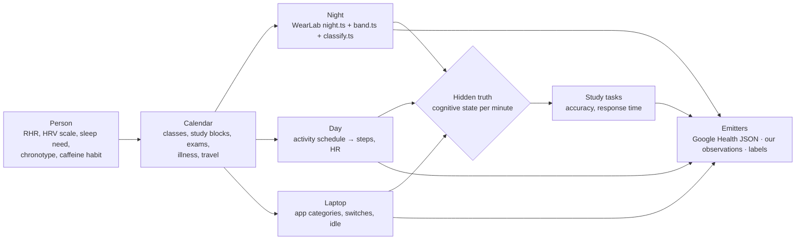

# Synthetic Data Generator

> [!success] Decided 2026-10-26
> We reuse WearLab's simulators as the core of our synthetic data. See [[20-decisions/adr-001-reuse-wearlab-simulators-for-synthetic-data|ADR-001]]. Heramb, WearLab's author, approved reusing the code.

## Why we need it

- **The course allows it, and the showcase almost requires it.** The synthetic path earns full credit. The showcase demands a recorded fallback and honest labelling of mocked data. → [[30-course/project-requirements|Project requirements]], [[30-course/deliverables/part-3-final-showcase|Part 3]]
- **Real data alone can't test us.** With real students we never know the true cause of a bad study session. A generator with a **hidden ground truth** lets us check two things: whether our pipeline, model and agents recover an effect we planted, and whether they correctly find *nothing* when we plant nothing. ^[inferred]
- **It exercises the failure paths.** Charging gaps, missing nights, sync lag, duplicate uploads and cadence-locked HR are rare in a short pilot but certain in production. ^[inferred]

**Non-goals.** This data never supports an accuracy or effectiveness claim. Every record says it's synthetic, and the UI shows a "Synthetic data" badge. → [[15-research/evaluation-plan|Evaluation plan]]

## What it produces: one simulated student, day by day

| Stream | Built from | Cadence | Emitted as | Truth kept in labels |
|---|---|---|---|---|
| Sleep session + stages | WearLab `makeNight` → `analyse` → `stage` → `report` | per night | Google Health `sleep` (STAGES, `stages[]`, summary) | lab hypnogram, true asleep minutes |
| Overnight summaries | band features + `nightOf()` from `recovery-model.ts` | per night | daily RHR, `rmssd_ms`, respiratory rate | true physiology |
| Skin temperature | `temp-model.ts` | per night | sleep temperature delta | illness / cycle events |
| Steps | cadence × minutes walked, with WearLab's measured error profile (short walks under 10 steps not counted, false steps on rough roads) | per minute | Google Health `steps` intervals | true steps |
| Heart rate | `dayTrace()` for the daytime curve; `PpgSim` only for short "break walk" segments | every 5 min, or 5 s for the Fitbit Air profile | Google Health `heart-rate` samples with `motionContext` | true HR |
| Laptop activity | **new** (WearLab has none) | events | our observations: `app_category`, `app_switch`, `idle_span`, `session` | true focus state |
| Study tasks | **new**, drawn from the hidden truth | per task | our `task_outcomes` | true expected accuracy |
| Break responses | **new** policy of a simulated student (accept, snooze, decline) | per suggestion | our `intervention_events` | whether the break was taken |

## The hidden truth (the most important design choice)

Each minute, the simulated student has a latent **cognitive readiness** that drives task accuracy and response time. A proposed starting form, with every coefficient set per scenario: ^[inferred]

- **It falls with:**
  - sleep debt against the person's sleep need;
  - continuous time on task since the last real break;
  - app-switching rate (a cause *and* a symptom);
  - illness days;
  - circadian dips by chronotype.
- **It recovers with:**
  - a break that was actually taken (confirmed by counted steps or idle time);
  - more strongly after a walk than after scrolling.
- **Task outcome:** accuracy = base × readiness + noise; response time scales inversely.

Every effect size is a parameter, and there are three standard worlds:
1. **Plausible world:** effects set from published typical sizes.
2. **Null world:** watch signals have *zero* effect on readiness. Our model must not "find" one. This protects the core hypothesis test in [[15-research/evaluation-plan|Evaluation plan]].
3. **Laptop-only world:** only behaviour matters, which tests the laptop-only fallback model in [[04-agent-engine/performance-model|Performance model]].

## Scenarios (named, seeded, reproducible)

| Scenario | What it tests |
|---|---|
| `normal-week` | The happy path and baseline learning |
| `exam-week` | Coffee and restless nights, long sessions, more switching |
| `ill-oct-2-4` | Mirrors course week 7: RHR and breathing up, HRV down, temperature up, steps down; tests that baselines exclude anomalous days |
| `off-wrist-and-charging` | About 1 h of no HR each morning, a missing night; tests abstention ("Not enough data") |
| `double-step-source` | A second overlapping import stream, as in course week 3; tests per-user source choice and dedup |
| `walk-cadence-lock` | HR locked onto step cadence during break walks; tests the HR quality gate |
| `late-chronotype` | Shifted bedtimes; tests that daily buckets use the local day |
| `dst-and-travel` | A clock change and a timezone change; tests UTC plus `utcOffset` handling |
| `sync-lag-and-dupes` | Delayed `received_at` and repeated uploads; tests the two-clocks rule and idempotent ingest |
| `null-world` | No real effect; the model must abstain or report no improvement |

## Output contract

1. **Google Health v4-shaped JSON**, so the demo exercises our real ingest path. It follows the week 3 shapes exactly:
   - numbers as strings, newest-first lists;
   - `physicalTime` plus a `utcOffset` string;
   - sleep assigned to the date it ends;
   - true-zero step points sometimes missing `count`.

   `dataSource.application.packageName` is `edu.columbia.cogperf.synthetic` and `device.displayName` is "Synthetic CogPerf Band". → [[30-course/weeks/week-03-wearable-sensors-and-measurements|Week 3]]
2. **Our canonical observations** for the laptop and task streams, matching [[05-data/data-pipeline|Data pipeline]]. `source` is `synthetic`, and `quality_status` is set honestly.
3. **A separate labels table** holding the truth (lab stages, true steps, readiness per minute, real break taken). It is never loaded into the app database. It's only for scoring.

## Where it lives and how it runs

- **Location:** `tools/synth/` in the team repo.
- **Vendored WearLab code:** `vendor/wearlab/` holds the ~10 files, **copied verbatim** with a header naming the source commit (`210abc4`).
  - Sleep: `night.ts`, `band.ts`, `classify.ts`, `model.gen.ts`
  - Steps: `body.ts`, `sensor.ts`, `counter.ts`, `sim.ts`
  - Labs: `recovery-model.ts`, `temp-model.ts`
  - Heart: `ppg.ts`
  - Plus WearLab's own `test-sleep.ts` and `test-steps.ts`, so we notice if our copy drifts.
- **Our code:** `person.ts`, `calendar.ts`, `day.ts`, `laptop.ts`, `tasks.ts`, `truth.ts`, `emit/google-health.ts`, `emit/observations.ts`, `scenarios/*.ts`, `cli.ts`.
- **Run:** `node --experimental-strip-types tools/synth/cli.ts --scenario exam-week --seed 3001 --days 28 --out data/synth/` (Node ≥ 22.6, no npm packages). The Python backend calls it as a subprocess or reads its files.
- **Seeds:** use 3000+ and stay outside 1–14 and 101–106, which WearLab used for training and testing the sleep stager.
- **Retraining:** if we free the fixed 23:00–07:00 night, retrain with our copy of `train-sleep.ts`. Never run it inside WearLab's own folder, because it rewrites `model.gen.ts`.

## How we know it works

- **Deterministic:** same scenario + seed → byte-identical output.
- **Shape tests:** every emitted file parses with our real ingest code and the week 3 parsing rules.
- **Coverage report:** readings per window, gaps by reason, matching the week 7 coverage idea (720 HR readings in a fully worn hour at 5 s sampling).
- **Planted-effect test:** in the plausible world our model recovers the planted direction; in the null world it doesn't.
- **WearLab's own tests still pass** on the vendored copy.

## Milestones (aligned to course dates)

| By | Milestone |
|---|---|
| Nov 6 (proposal) | One `normal-week` sample day with a plot, used on the "data sources and access plan" slide |
| Nov 13 | Vendored code, person and calendar layers, and the Google Health emitter for sleep, steps and HR |
| Nov 20 | Laptop and task streams, the hidden truth, the three worlds and all scenarios |
| Dec 4 (integration checkpoint) | 28 synthetic days run end to end through ingest → features → model → agents → UI |
| Dec 11 (showcase) | Recorded fallback demo on `exam-week`, clearly labelled synthetic |

Estimated effort: about 1–2 days for the WearLab wrapper, plus about 2 days for the laptop, task and truth layers. ^[inferred]

## Open questions

- Fitbit Air profile: HR every 5 s (the week 7 synthetic data) or every 5 min (the week 3 sample)? Generate both, and confirm against the device we actually borrow. → [[24-synthesis/open-decisions|Open decisions]] #18
- Should the simulated student's accept/snooze/decline policy be learned from pilot data later?
- Do we mix real pilot data and synthetic days in one demo? Proposed: no; keep them separate and labelled.

## Related

- [[20-decisions/adr-001-reuse-wearlab-simulators-for-synthetic-data|ADR-001]] · [[32-wearlab/what-we-reuse|What we reuse from WearLab]] · [[32-wearlab/motion-sleep-recovery-pipelines|Motion, sleep and recovery pipelines]] · [[05-data/data-sources|Data sources]] · [[05-data/data-pipeline|Data pipeline]]
