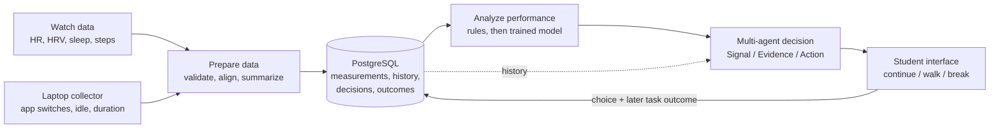

# System Architecture

The architecture of the [[projects/cognitive-performance-agent/cognitive-performance-agent|Cognitive Performance Agent]]. Both designs agree on the same logical stages. They differ on how many apps and how much infrastructure to build first.

## The five stages

1. **Collect.** Watch and laptop data plus study-task results. → [[projects/cognitive-performance-agent/concepts/data-sources|Data sources]]
2. **Prepare and store.** Validate, clean, time-align and save to PostgreSQL. → [[projects/cognitive-performance-agent/concepts/data-pipeline|Data pipeline]]
3. **Analyze.** Compute features and return an estimate with uncertainty, using numeric code rather than the LLM. → [[projects/cognitive-performance-agent/concepts/performance-model|Performance model]]
4. **Agents decide.** Signal, Evidence and Action agents propose a step, and deterministic code approves or blocks it. → [[projects/cognitive-performance-agent/concepts/multi-agent-decision|Multi-agent decision]]
5. **Show and measure.** The student accepts, snoozes or declines, and a later comparable task measures the result. → [[projects/cognitive-performance-agent/concepts/student-interface-and-feedback|Student interface and feedback]]

Consent, user-only data access, and pause/delete apply to every stage. → [[projects/cognitive-performance-agent/concepts/privacy-and-consent|Privacy and consent]]

## Raghavan's packaging: one app, one backend, one database

From the [[projects/cognitive-performance-agent/references/raghavan-architecture-deck|architecture deck]]:

- **One Electron desktop app** collects laptop data and shows the React UI.
- **One Python (FastAPI) backend** does preparation, analysis and the agents.
- **One PostgreSQL database** stores everything, including the background-task to-do list.
- No vector database, queue platform or Kubernetes for the pilot.

## Alexa's packaging: modular monolith plus workers

From the [[projects/cognitive-performance-agent/references/alexa-kafka-system-design|system design doc]]:

- **Three clients:** a React Native mobile app, a Next.js web app and an opt-in desktop collector, all reaching the backend through an HTTPS / OIDC API edge.
- **A FastAPI modular backend** with three areas: auth and consent, the recommendation workflow, and integration adapters.
- **Managed PostgreSQL with pgvector**, a **durable task queue**, and **async workers** running validation → features → model inference.
- After the workers come a policy engine with evidence retrieval, then recommendation and outcome tracking, then an experiment/evaluation pipeline.
- Logical module boundaries live in code even when they share one deployment unit. Services are split out only when measured need justifies it.

## Shared principles

- **Quality before intelligence.** Stale, sparse or missing data must be visible to the decision step.
- **Models propose, code decides.** No LLM makes the final safety, consent or access decision.
- **Abstain when unsure.** Show "Not enough data" instead of a confident guess.
- **Graceful degradation.** A missing wearable or LLM outage must not break the core app.
- **Start small.** Add complexity only when measured need justifies it. ^[inferred]

## Sources

- [[projects/cognitive-performance-agent/references/raghavan-architecture-deck]] — slides 1, 3
- [[projects/cognitive-performance-agent/references/alexa-kafka-system-design]] — §2.3, §3, §5.2
